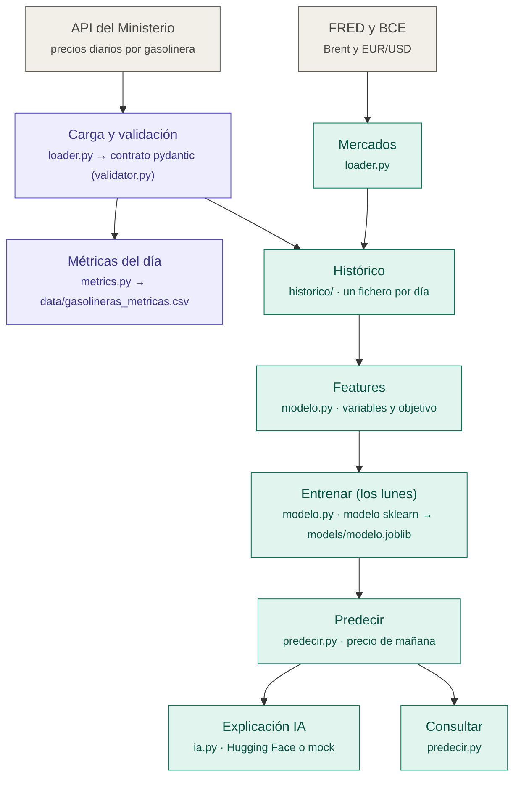

# Pipeline de la parte B · precios de carburantes

Todos los pasos se lanzan con `python -m pipeline_dsia <comando>`.

Morado: Proyecto I (métricas del día, `python -m pipeline_dsia metricas`).
Verde: Proyecto II (ingesta histórica, modelo, predicción e IA).

## Etapas

| Etapa | Comando · módulo | Entrada | Salida |
|-------|--------|---------|--------|
| Carga | `metricas` · `loader.py` | API del Ministerio (JSON) | DataFrame crudo; reintentos y 3 métodos de conexión |
| Validación | `validator.py` | DataFrame crudo | Estaciones válidas + nº de inválidas (contrato pydantic, duplicados) |
| Métricas | `metricas` · `metrics.py` | Estaciones válidas | Medias por provincia y marca, ranking, CSV de métricas |
| Mercados | `ingesta` · `loader.py` | FRED (Brent) y BCE (EUR/USD) | Brent en €/barril |
| Histórico | `ingesta` · `historico.py` | Estaciones válidas + mercados | `historico/` con un fichero por día |
| Features | `entrenar`, `predecir` · `modelo.py` | Histórico | Variables y objetivo del modelo |
| Entrenar | `entrenar` · `modelo.py` | Features | `models/modelo.joblib`, métricas e informe |
| Predecir | `predecir` · `predecir.py` | Modelo + último día | Predicción de mañana e informe |
| Explicación | `predecir` · `ia.py` | Predicción | Texto explicativo (Hugging Face o mock) |
| Consultar | `consultar` · `predecir.py` | Predicciones | Filtros por provincia, municipio, estación o marca |

## Automatización

- `scripts/pipeline_local.ps1` (Programador de tareas de Windows): cada día ejecuta
  ingesta → entrenar (los lunes) → predecir y sube el histórico y el modelo al repo.
- `.github/workflows/pipeline_diario.yml`: lo mismo en GitHub Actions, lanzado a mano.
- `.github/workflows/ci.yml`: en cada push y pull request ejecuta los tests de las partes A y B.
